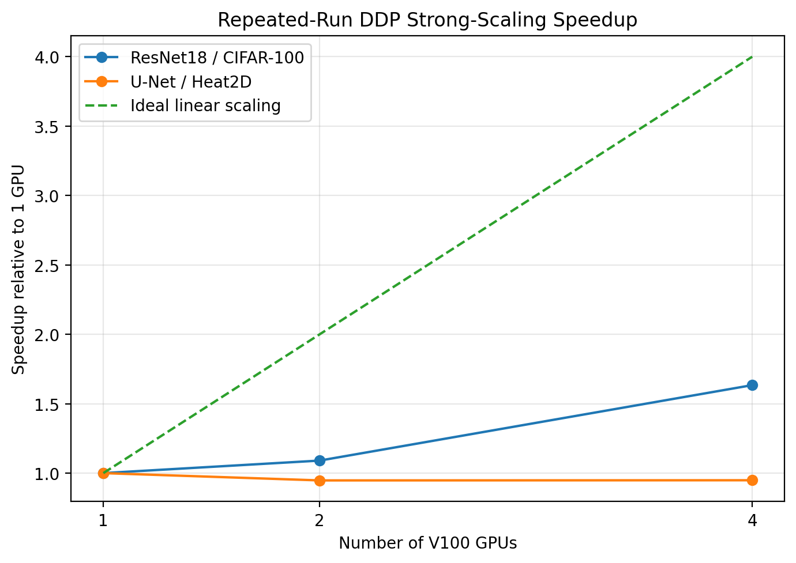

<div align="center">

# DDP Scaling Anatomy

### Profiling why more GPUs don't always mean faster training, and fixing it

**A PyTorch DistributedDataParallel (DDP) study on 4× NVIDIA V100s: strong-scaling benchmarks, NCCL profiling, and a profiler-verified communication optimization.**


</div>

---

## TL;DR

I trained two workloads with DDP on 1, 2 and 4 V100 GPUs. One got faster. The other got **slower**. I used the PyTorch Profiler to find out why, and then cut gradient synchronization by 75% to win back throughput.

| | Result |
|---|---:|
| ResNet18 / CIFAR-100, 1 → 4 GPUs | **1.63× speedup** (40.9% efficiency) |
| U-Net / Heat2D, 1 → 4 GPUs | **0.95× (slower than 1 GPU)** |
| SyncBatchNorm vs BatchNorm (4 GPUs) | **−46% throughput**, same accuracy |
| `DDP.no_sync()` gradient accumulation | **+9.7% throughput** |
| Gradient all-reduces per optimizer step | **12 → 3** (verified in profiler) |
| NCCL kernel residency | **233.5 → 150.1 ms (−36%)** |

All final numbers are the **mean of 3 repeated runs** on NVIDIA Tesla V100-SXM2-32GB under Slurm + `torchrun`.

<p align="center">
  
</p>

> **Main finding:** extra GPUs only help when the parallel compute they add outweighs the communication needed to keep them in sync. When each GPU's share of the work gets too small, DDP makes training slower.

---

## What this project demonstrates

| Area | What I did |
|---|---|
| **Distributed training** | DDP from scratch with `torchrun`: process groups, rank/local-rank handling, `DistributedSampler`, FP16 AMP |
| **Correctness** | Standalone tests for collectives, sampler partitioning, and parameter/gradient sync across ranks |
| **Benchmarking** | Strong scaling with a fixed global batch, warm-up excluded, timing taken from the slowest rank, 3 repeats with std / CV / 95% CI |
| **Profiling** | PyTorch Profiler traces, NCCL kernel counts and residency per rank, comparison of communication against step time |
| **Ablations** | BatchNorm vs SyncBatchNorm, naive gradient accumulation vs `DDP.no_sync()` |
| **HPC** | Slurm job scripts for every experiment, run on a shared V100 cluster |
| **Engineering** | Installable `src/` package, YAML configs, GitHub Actions CI, reproducible analysis scripts, raw JSON results committed |

---

## 1. Strong scaling: one workload scales, one doesn't

Strong scaling keeps the **global batch fixed**, so each GPU gets `B_local = B_global / N` samples. Adding GPUs shrinks the compute per GPU, but the gradient all-reduce still has to happen every step.

<table>
<tr>
<th>ResNet18 / CIFAR-100</th>
<th>U-Net / Heat2D (SciML surrogate)</th>
</tr>
<tr>
<td>

11.2M params · global batch 256 · SGD · BatchNorm

| GPUs | Local batch | Throughput (img/s) | Speedup |
|---:|---:|---:|---:|
| 1 | 256 | 8057 ± 105 | 1.00× |
| 2 | 128 | 8784 ± 462 | 1.09× |
| 4 | 64 | **13163 ± 271** | **1.63×** |

</td>
<td>

7.7M params · global batch 16 · AdamW · GroupNorm

| GPUs | Local batch | Throughput (fields/s) | Speedup |
|---:|---:|---:|---:|
| 1 | 16 | 1046 ± 28 | 1.00× |
| 2 | 8 | 991 ± 35 | 0.95× |
| 4 | 4 | **992 ± 18** | **0.95×** |

</td>
</tr>
</table>

The U-Net uses GroupNorm on purpose, so its normalization doesn't degrade as the local batch shrinks to 4. That leaves communication as the cause of the slowdown.

---

## 2. Profiling: why did the U-Net stop scaling?

In the 4-GPU configuration, both models issue about **3 gradient all-reduces per step**. ResNet18 actually spends *more* absolute time in NCCL kernels, and it still scales better.

| Workload | GPUs | All-reduces / step | Mean NCCL residency | Step time |
|---|---:|---:|---:|---:|
| ResNet18 | 1 | 0 | 0 ms | 31.77 ms |
| ResNet18 | 4 | 3 | 11.81 ms | 19.45 ms |
| U-Net | 1 | 0 | 0 ms | 15.30 ms |
| U-Net | 4 | 3 | 7.50 ms | **16.13 ms** |

<p align="center">
  
</p>

**Diagnosis:** the total amount of communication doesn't explain scaling on its own. What matters is **communication relative to useful local compute**, plus how much of it overlaps with compute. With 4 samples per GPU, the U-Net doesn't have enough work to hide the all-reduce.

---

## 3. Ablation: the cost of SyncBatchNorm

SyncBatchNorm synchronizes normalization statistics across ranks in every BN layer.

| Normalization | Throughput (img/s) | Val. accuracy | Epoch time |
|---|---:|---:|---:|
| BatchNorm | **13163 ± 271** | 40.47% ± 2.86 | 3.53 s |
| SyncBatchNorm | 7062 ± 57 | 40.29% ± 3.50 | 6.48 s |

**−46% throughput, +84% epoch time, no accuracy gain** in this setup. The profiler shows the cause: about **20 extra all-gathers in the forward pass and 20 extra reductions in the backward pass per step**, on top of the usual 3 gradient all-reduces.

<p align="center">
  
</p>

---

## 4. Optimization: `DDP.no_sync()` gradient accumulation

The U-Net is communication-bound, so the fix is to **synchronize less often**. Setup: 4 GPUs, 4 samples per GPU per microbatch, 4 accumulation steps, effective global batch of 64.

```text
Naive accumulation                      DDP.no_sync()
──────────────────                      ─────────────
micro 1 → backward → all-reduce         micro 1 → local backward
micro 2 → backward → all-reduce         micro 2 → local backward
micro 3 → backward → all-reduce         micro 3 → local backward
micro 4 → backward → all-reduce         micro 4 → backward → all-reduce
            ↓ optimizer.step()                      ↓ optimizer.step()
```

The model, data, optimizer, effective batch, loss scaling and number of updates are identical in both modes. **Only how often gradients are synchronized changes.**

| Mode | Throughput (fields/s) | All-reduces / update | NCCL residency | Val. MSE |
|---|---:|---:|---:|---:|
| Naive | 1072 ± 16 | 12 | 233.5 ms | 0.004677 |
| `no_sync()` | **1176 ± 11** | **3** | **150.1 ms** | 0.004689 |

**+9.67% throughput** with no change in model quality. The profiler confirms what happened: **48 → 12** all-reduces over 4 updates, which is 75% fewer synchronizations.

<p align="center">
  
</p>

```text
poor scaling → profile NCCL → identify comm-bound workload
            → remove redundant syncs → verify in profiler → measure speedup
```

---

## Quick start

```bash
git clone https://github.com/meanderinghuman/ddp-scaling-anatomy.git
cd ddp-scaling-anatomy

pip install -r requirements.txt
pip install -e .

python scripts/01_check_environment.py     # check torch / CUDA / NCCL
python scripts/02_test_resnet.py           # CPU smoke test
python scripts/03_generate_heat_data.py    # build the Heat2D dataset
python scripts/04_audit_heat_data.py
```

**Multi-GPU run (4× GPU, single node):**

```bash
torchrun --standalone --nproc-per-node=4 \
    scripts/10_train_ddp.py \
    --config configs/resnet18_v100.yaml \
    --device cuda --backend nccl --num-workers 2
```

**On a Slurm cluster:** every experiment has a job script in [`scripts/slurm/`](scripts/slurm/), covering smoke tests, benchmarks, repeated runs, profiling, SyncBN and gradient accumulation.

---

## Repository layout

```text
├── src/ddp_lab/            # installable package: models, data, DDP training utilities
├── configs/                # YAML configs for each workload (local + V100)
├── scripts/                # numbered pipeline, 01_check_environment → 22_profile_grad_accum
│   └── slurm/              # HPC job scripts
├── results/rosi_v100/      # raw JSON, CSV summaries, and figures for every experiment
│   ├── repeated_runs/      #   strong scaling (3× repeats)
│   ├── profiling/          #   NCCL profiler analysis
│   ├── syncbn/             #   normalization ablation
│   └── optimization/       #   no_sync experiment
├── tests/                  # data pipeline tests
├── docs/PROJECT_REPORT.md  # full write-up: theory, equations, methodology
└── .github/workflows/      # CI: CPU smoke tests on every push
```

---

## Methodology

- **Hardware:** NVIDIA Tesla V100-SXM2-32GB, 4 GPUs per node · PyTorch 2.10 + CUDA 12.8 · NCCL · FP16 AMP
- **Strong scaling:** fixed global batch; same model, data and optimizer at every GPU count
- **Timing:** warm-up batches and the first epoch excluded; throughput taken from the **slowest rank**
- **Statistics:** 3 runs per configuration, reported with std, coefficient of variation and Student-t 95% CI
- **Baseline:** always the 1-GPU V100 run; laptop numbers are never mixed with HPC numbers
- **Profiler caveat:** NCCL kernel residency is used as a *diagnostic*, not as wall-clock overhead, because communication and compute can overlap

The full derivations and experiment walkthrough are in **[docs/PROJECT_REPORT.md](docs/PROJECT_REPORT.md)**.

## Scope

This is a deliberately controlled **single-node data-parallel** study. Multi-node networking, FSDP/ZeRO, tensor or pipeline parallelism, and LLM-scale training are out of scope. The models fit on one GPU on purpose, so that the results isolate data-parallel communication behavior.

## License

[MIT](LICENSE) © 2026 Siddharth Pal
