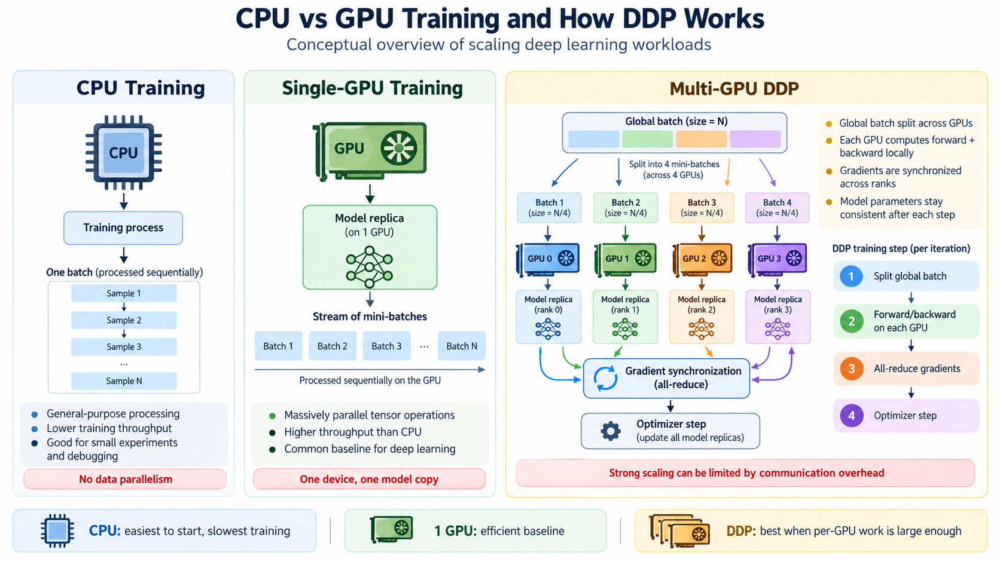
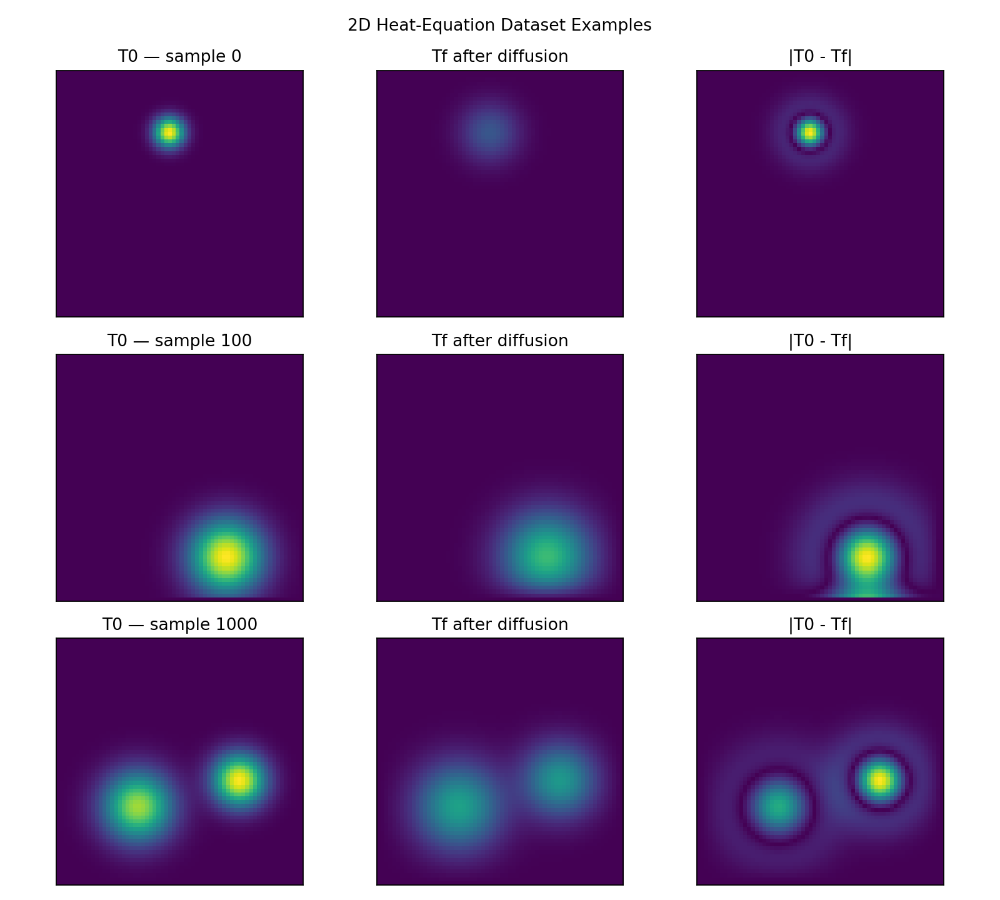
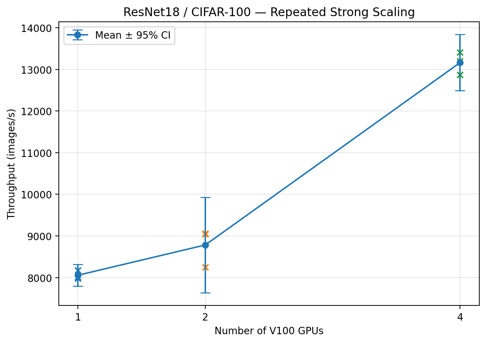
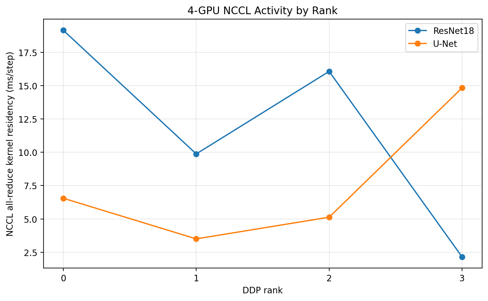
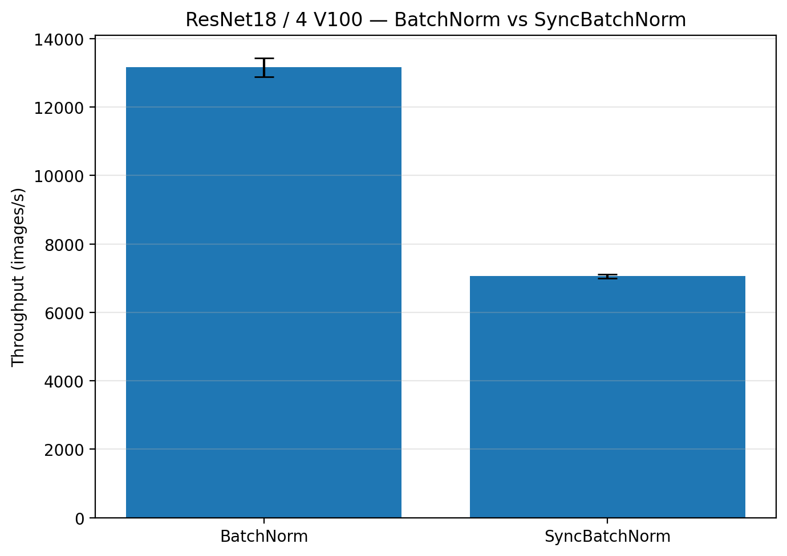
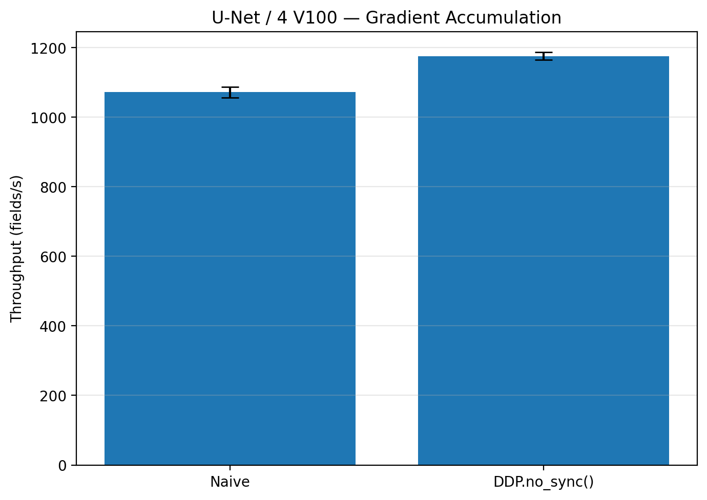

# DDP Scaling Anatomy — Detailed Project Report

**Author:** [meanderinghuman](https://github.com/meanderinghuman) · **Repository:** [ddp-scaling-anatomy](https://github.com/meanderinghuman/ddp-scaling-anatomy)

A hands-on systems study of **PyTorch DistributedDataParallel (DDP)**, **NCCL communication**, strong scaling, profiling, and communication-aware optimization on NVIDIA V100 GPUs.

The central question is simple:

> **When does adding GPUs actually make training faster — and what can we do when it does not?**

This project studies that question using two different workloads:

- **ResNet18 / CIFAR-100** — image classification
- **U-Net / 2D heat-equation surrogate** — scientific machine learning regression

The project progresses from basic distributed-training correctness to multi-GPU scaling, communication profiling, normalization experiments, and finally a measured DDP communication optimization.

---

## Key Results

All final scaling numbers below use **three repeated runs per GPU configuration** on a single V100 node.

| Experiment | Main result |
|---|---:|
| ResNet18, 1 → 4 GPUs | **1.63× speedup** |
| ResNet18, 4-GPU efficiency | **40.85%** |
| U-Net, 1 → 4 GPUs | **0.95× speedup** |
| SyncBatchNorm vs BatchNorm | **−46.35% throughput** |
| `DDP.no_sync()` optimization | **+9.67% throughput** |
| Gradient synchronization count | **12 → 3 all-reduces/update** |
| NCCL kernel residency | **233.5 → 150.1 ms** |
| NCCL residency reduction | **≈35.7%** |

The main conclusion is that **GPU count alone does not determine distributed-training performance**.

Scaling depends on the balance between:

$$
\text{useful computation}
\quad\text{and}\quad
\text{communication + synchronization}.
$$

---

## Project Overview

The project is organized into three phases.

```text
Phase 1
└── Build and benchmark DDP strong scaling
    ├── ResNet18
    ├── U-Net
    └── 1 / 2 / 4 V100 GPUs

Phase 2
└── Diagnose scaling behavior
    ├── repeated benchmarks
    ├── PyTorch / NCCL profiling
    └── BatchNorm vs SyncBatchNorm

Phase 3
└── Optimize communication
    ├── naive gradient accumulation
    ├── DDP.no_sync()
    └── profiler verification
```

---

# 1. How DDP Works

PyTorch DDP uses **one process per GPU**.

Each process:

1. owns a full copy of the model,
2. receives a different part of the dataset,
3. performs forward and backward computation locally,
4. synchronizes gradients with the other ranks,
5. performs the same optimizer update.

Conceptually:



The distributed stack used in this project is:

```text
Slurm
   ↓
torchrun
   ↓
one Python process / GPU
   ↓
PyTorch DistributedDataParallel
   ↓
NCCL collectives
   ↓
NVIDIA V100 GPUs
```

---

# 2. Strong Scaling

This project studies **strong scaling**.

The global batch size remains fixed while the number of GPUs increases.

For $N$ GPUs,

$$
B_{\mathrm{local}}
=
\frac{B_{\mathrm{global}}}{N}.
$$

For ResNet18:

| GPUs | Global batch | Local batch / GPU |
|---:|---:|---:|
| 1 | 256 | 256 |
| 2 | 256 | 128 |
| 4 | 256 | 64 |

For U-Net:

| GPUs | Global batch | Local batch / GPU |
|---:|---:|---:|
| 1 | 16 | 16 |
| 2 | 16 | 8 |
| 4 | 16 | 4 |

This is important because adding GPUs reduces the amount of useful computation performed by each GPU while gradient synchronization still remains necessary.

---

# 3. Workloads

## ResNet18 / CIFAR-100

The first workload is a CIFAR-adapted ResNet18.

Changes from the ImageNet version include:

- 3×3 first convolution,
- stride 1,
- no initial max-pooling,
- 100 output classes.

Model size:

```text
11,220,132 parameters
```

Training:

```text
Loss       : CrossEntropyLoss
Optimizer  : SGD + momentum
Global batch: 256
Precision  : FP16 AMP on V100
```

Standard BatchNorm is retained in the baseline model.

---

## U-Net / Heat2D

The second workload is a U-Net trained as a surrogate for a synthetic 2D heat-equation problem.

Model size:

```text
7,699,009 parameters
```

Architecture:

```text
Encoder:
64 → 128 → 256

Bottleneck:
512

Decoder:
transpose convolution
+ skip connections
```

Training:

```text
Loss        : MSE
Optimizer   : AdamW
Global batch: 16
Precision   : FP16 AMP
```

The U-Net uses **GroupNorm** rather than BatchNorm so that normalization statistics do not change as local batch size decreases during strong scaling.

Example Heat2D samples:



---

# 4. Phase 1 — DDP Strong Scaling

The first phase implements and validates the full distributed-training stack.

Before running real GPU benchmarks, the project tests:

- distributed process initialization,
- ranks and world size,
- collective communication,
- `DistributedSampler`,
- parameter broadcast,
- gradient synchronization,
- DDP optimizer consistency.

The progression is implemented in:

```text
scripts/07_test_distributed_primitives.py
scripts/08_test_distributed_sampler.py
scripts/09_test_ddp_sync.py
scripts/10_train_ddp.py
```

---

## Throughput

Throughput is measured as

$$
Q_N
=
\frac{\text{global measured samples}}
{\text{slowest-rank measured time}}.
$$

Speedup is

$$
S_N
=
\frac{Q_N}{Q_1},
$$

and strong-scaling efficiency is

$$
E_N
=
\frac{S_N}{N}\times100\%.
$$

The first epoch is excluded from the final steady-state summary because it contains startup effects.

---

# 5. Phase 2A — Repeated Strong-Scaling Benchmarks

Each GPU configuration was repeated **three times** to measure runtime variability.

## ResNet18

| GPUs | Local batch | Mean throughput | Std | Speedup | Efficiency |
|---:|---:|---:|---:|---:|---:|
| 1 | 256 | **8056.89 img/s** | 105.23 | 1.000× | 100.00% |
| 2 | 128 | **8783.87 img/s** | 461.61 | 1.090× | 54.51% |
| 4 | 64 | **13163.49 img/s** | 271.37 | **1.634×** | 40.85% |

ResNet18 gains substantial throughput at four GPUs, although scaling is far from ideal.



---

## U-Net

| GPUs | Local batch | Mean throughput | Std | Speedup | Efficiency |
|---:|---:|---:|---:|---:|---:|
| 1 | 16 | **1046.12 fields/s** | 27.76 | 1.000× | 100.00% |
| 2 | 8 | **991.05 fields/s** | 35.32 | 0.947× | 47.37% |
| 4 | 4 | **992.26 fields/s** | 18.12 | **0.949×** | 23.71% |

The U-Net does **not** benefit from additional GPUs.

Four GPUs are slightly slower than one GPU.


This is the first major result of the project:

> **Distributed training can reduce performance when the local workload becomes too small relative to synchronization cost.**

---

# 6. Phase 2B — PyTorch / NCCL Profiling

To understand the scaling behavior, short profiler runs were performed for:

```text
ResNet18
    1 GPU
    4 GPUs

U-Net
    1 GPU
    4 GPUs
```

The profiler captures:

- CUDA kernels,
- NCCL collectives,
- DDP gradient synchronization,
- forward/backward operations,
- optimizer activity.

The 4-GPU U-Net run performs approximately:

```text
3 DDP all-reduces / training step
```

The same is true for ResNet18.

However, the workloads behave very differently.

| Workload | GPUs | Local batch | All-reduces/step | Mean NCCL residency | Benchmark step time |
|---|---:|---:|---:|---:|---:|
| ResNet18 | 1 | 256 | 0 | 0 ms | 31.77 ms |
| ResNet18 | 4 | 64 | 3 | 11.81 ms | 19.45 ms |
| U-Net | 1 | 16 | 0 | 0 ms | 15.30 ms |
| U-Net | 4 | 4 | 3 | 7.50 ms | 16.13 ms |

The interesting observation is that **ResNet shows more NCCL kernel activity than U-Net but still scales better**.

Therefore:

> Absolute communication time alone does not determine scaling.

The more important quantity is the ratio between communication and useful local computation, including how much communication can overlap the backward pass.



Profiler NCCL kernel residency is treated as a diagnostic quantity only. It is **not interpreted as pure wall-clock communication overhead**, because CUDA computation and NCCL communication can overlap.

---

# 7. Phase 2C — BatchNorm vs SyncBatchNorm

ResNet18 uses standard BatchNorm in the baseline.

Under DDP, BatchNorm statistics are local to each rank:

```text
1 GPU → batch statistics from 256 samples

4 GPUs → each rank sees only 64 samples
```

A second experiment converts all BatchNorm layers to `SyncBatchNorm`, which synchronizes statistics across GPUs.

Three 4-GPU runs were performed for each condition.

| Normalization | Throughput | Val accuracy | Epoch time | VRAM/rank |
|---|---:|---:|---:|---:|
| BatchNorm | **13163.49 ± 271.37 img/s** | 40.47% ± 2.86 pp | 3.526 s | 0.327 GiB |
| SyncBatchNorm | **7061.68 ± 57.10 img/s** | 40.29% ± 3.50 pp | 6.478 s | 0.327 GiB |

SyncBatchNorm caused:

$$
\boxed{-46.35\%\text{ throughput}}
$$

and

$$
\boxed{+83.73\%\text{ epoch time}}.
$$

There was no meaningful short-run accuracy improvement.



---

## Why was SyncBatchNorm so expensive?

The profiler explains it.

### Ordinary DDP ResNet

Approximately:

```text
3 gradient all-reduces / step
2 buffer broadcasts / step
```

### SyncBatchNorm ResNet

Approximately:

```text
20 SyncBN all-gathers / step
20 SyncBN backward all-reduces / step
 3 DDP gradient all-reduces / step
 2 buffer broadcasts / step
```

The model contains roughly 20 normalization layers, so synchronizing statistics at each layer creates many small collective operations.

This produces a clear engineering lesson:

> Fine-grained synchronization can dominate runtime even when the total model is relatively small.

---

# 8. Phase 3 — Communication Optimization with `DDP.no_sync()`

The U-Net was the most communication-limited workload, so it was used for the optimization experiment.

The setup is:

```text
GPUs                 : 4
microbatch / GPU     : 4
accumulation steps   : 4
effective global batch: 64
```

The effective batch is

$$
B_{\mathrm{effective}}
=
4\times4\times4
=
64.
$$

Two mathematically equivalent accumulation strategies are compared.

---

## Naive Gradient Accumulation

```text
microbatch 1
    backward
    all-reduce

microbatch 2
    backward
    all-reduce

microbatch 3
    backward
    all-reduce

microbatch 4
    backward
    all-reduce

optimizer.step()
```

DDP therefore synchronizes gradients after every microbatch.

---

## Gradient Accumulation with `DDP.no_sync()`

```text
microbatch 1
    local backward only

microbatch 2
    local backward only

microbatch 3
    local backward only

microbatch 4
    backward + synchronization

optimizer.step()
```

The first three microbatches accumulate gradients locally.

Only the final microbatch performs DDP synchronization.

---

## Performance

| Mode | Throughput | Train time | Final val MSE | VRAM/rank |
|---|---:|---:|---:|---:|
| Naive accumulation | **1071.95 ± 15.50 fields/s** | 3.831 s | 0.004677 | 0.251 GiB |
| `DDP.no_sync()` | **1175.56 ± 10.87 fields/s** | 3.492 s | 0.004689 | 0.253 GiB |

This gives:

$$
\boxed{+9.67\%\text{ throughput}}
$$

and

$$
\boxed{-8.83\%\text{ training time}}.
$$

Validation MSE and memory usage remain essentially unchanged.



---

# 9. Profiler Verification of `no_sync()`

The final profiler experiment directly measures the number of NCCL gradient synchronizations.

For four optimizer updates:

| Mode | Total all-reduces | All-reduces/update | NCCL kernel residency |
|---|---:|---:|---:|
| Naive accumulation | **48** | **12** | 233.49 ms |
| `DDP.no_sync()` | **12** | **3** | 150.12 ms |

Therefore,

$$
48\rightarrow12
$$

is a

$$
\boxed{75\%\text{ reduction in synchronization count}}.
$$

The summed NCCL kernel residency also drops by approximately:

$$
\boxed{35.7\%}.
$$

This produces the complete optimization chain:

```text
identify poor scaling
        ↓
profile NCCL communication
        ↓
find excessive synchronization
        ↓
use DDP.no_sync()
        ↓
75% fewer gradient synchronizations
        ↓
35.7% lower NCCL kernel residency
        ↓
9.67% higher training throughput
```

---

# 10. Repository Structure

```text
ddp-scaling-anatomy/
│
├── .github/
│   └── workflows/
│       └── ci.yml
│
├── configs/
│   ├── resnet18.yaml
│   ├── resnet18_v100.yaml
│   ├── unet_heat.yaml
│   └── unet_heat_v100.yaml
│
├── docs/
│   └── PROJECT_REPORT.md
│
├── results/
│   ├── figures/
│   │
│   └── rosi_v100/
│       ├── analysis/
│       ├── figures/
│       ├── raw/
│       │
│       ├── repeated_runs/
│       ├── profiling/
│       ├── syncbn/
│       └── optimization/
│
├── scripts/
│   ├── 01_check_environment.py
│   ├── 02_test_resnet.py
│   ├── 03_generate_heat_data.py
│   ├── 04_audit_heat_data.py
│   ├── 05_test_unet.py
│   ├── 06_train_single_gpu.py
│   ├── 07_test_distributed_primitives.py
│   ├── 08_test_distributed_sampler.py
│   ├── 09_test_ddp_sync.py
│   ├── 10_train_ddp.py
│   ├── 11_compile_scaling_results.py
│   ├── 12_make_readme_figures.py
│   ├── 14_compile_repeated_results.py
│   ├── 15_profile_ddp.py
│   ├── 16_analyze_profiler.py
│   ├── 17_train_syncbn_ablation.py
│   ├── 18_analyze_syncbn.py
│   ├── 19_profile_syncbn.py
│   ├── 20_train_gradient_accumulation.py
│   ├── 21_analyze_gradient_accumulation.py
│   ├── 22_profile_gradient_accumulation.py
│   │
│   └── slurm/
│
├── src/
│   └── ddp_lab/
│       ├── data/
│       ├── models/
│       ├── training/
│       └── utils/
│
├── tests/
│   └── test_data.py
│
├── LICENSE
├── pyproject.toml
├── requirements.txt
└── README.md
```

---

# 11. Installation

Clone the repository and install the project.

```bash
git clone https://github.com/meanderinghuman/ddp-scaling-anatomy.git
cd ddp-scaling-anatomy
```

Create or activate a Python environment with PyTorch installed, then:

```bash
pip install -e .
```

or:

```bash
pip install -r requirements.txt
```

Check the environment:

```bash
python scripts/01_check_environment.py
```

---

# 12. Generate the Heat2D Dataset

The synthetic Heat2D dataset is generated locally and is not committed to Git.

Generate:

```bash
python scripts/03_generate_heat_data.py
```

Audit it:

```bash
python scripts/04_audit_heat_data.py
```

Run data tests:

```bash
python -m pytest
```

---

# 13. Single-GPU Training

ResNet18:

```bash
python scripts/06_train_single_gpu.py \
    --config configs/resnet18.yaml
```

U-Net:

```bash
python scripts/06_train_single_gpu.py \
    --config configs/unet_heat.yaml
```

---

# 14. Distributed Correctness Tests

Test distributed primitives:

```bash
torchrun \
    --standalone \
    --nproc-per-node=2 \
    scripts/07_test_distributed_primitives.py
```

Test distributed data sampling:

```bash
torchrun \
    --standalone \
    --nproc-per-node=2 \
    scripts/08_test_distributed_sampler.py
```

Test DDP parameter and gradient synchronization:

```bash
torchrun \
    --standalone \
    --nproc-per-node=2 \
    scripts/09_test_ddp_sync.py
```

These tests can run with CPU/Gloo and do not require multiple GPUs.

---

# 15. Multi-GPU Training

Example: ResNet18 on four GPUs.

```bash
torchrun \
    --standalone \
    --nproc-per-node=4 \
    scripts/10_train_ddp.py \
    --config configs/resnet18_v100.yaml \
    --device cuda \
    --backend nccl \
    --num-workers 2
```

Example: U-Net on four GPUs.

```bash
torchrun \
    --standalone \
    --nproc-per-node=4 \
    scripts/10_train_ddp.py \
    --config configs/unet_heat_v100.yaml \
    --device cuda \
    --backend nccl \
    --num-workers 2
```

---

# 16. Slurm

Example Slurm launch scripts are available under:

```text
scripts/slurm/
```

The project includes jobs for:

- environment validation,
- 1/2/4 GPU smoke tests,
- full DDP benchmarks,
- repeated benchmark runs,
- profiler runs,
- SyncBatchNorm experiments,
- gradient-accumulation experiments.

---

# 17. Hardware Used for Final Benchmarks

Final multi-GPU experiments were run on a single HPC node using:

```text
GPU        : NVIDIA Tesla V100-SXM2-32GB
GPU memory : 32 GB
PyTorch    : 2.10.0+cu128
CUDA       : 12.8
Backend    : NCCL
Precision  : FP16 automatic mixed precision
```

The final scaling denominator is always the **1-GPU V100 result**.

Local laptop results are not mixed into the HPC scaling calculations.

---

# 18. Benchmark Methodology

Several rules were used to keep the performance comparison meaningful.

### Fixed global batch

Strong scaling keeps the global batch fixed.

### Same training problem

Changing GPU count does not change:

- model architecture,
- dataset,
- optimizer,
- loss function,
- global batch,
- precision mode.

### Warm-up exclusion

Initial batches are excluded from timing to reduce startup effects.

### First epoch excluded

Epoch 1 is not used for steady-state throughput because it includes initialization and warm-up overhead.

### Slowest-rank timing

Distributed throughput uses the slowest participating rank.

This avoids reporting artificially optimistic performance when one rank is delayed.

### Repeated benchmarks

Final scaling results use three independent runtime repetitions per configuration.

---

# 19. Main Lessons

### More GPUs do not guarantee more throughput

The U-Net demonstrates a classic strong-scaling limit.

As GPU count increases:

$$
B_{\mathrm{local}}
\downarrow
$$

while synchronization requirements remain.

Eventually communication dominates useful local work.

---

### Communication cost must be interpreted relative to computation

ResNet18 contains substantial NCCL activity but still benefits from four GPUs.

U-Net contains less absolute NCCL activity but scales poorly.

Therefore:

> The relevant question is not simply “How expensive is communication?” but “How expensive is communication relative to the amount of useful computation available to hide or amortize it?”

---

### Fine-grained synchronization can be very expensive

SyncBatchNorm introduced roughly:

```text
20 all-gathers / step
20 additional all-reduces / step
```

and reduced throughput by almost half.

---

### `DDP.no_sync()` can remove redundant communication

When gradient accumulation is required, synchronizing every microbatch is unnecessary.

Suppressing intermediate synchronization reduced the measured number of all-reduces by 75% and improved end-to-end throughput by 9.67%.

---

# 20. Limitations

This project intentionally focuses on a controlled single-node DDP study.

Current limitations include:

- single-node training only,
- NVIDIA V100 hardware for final benchmarks,
- maximum of four GPUs,
- relatively small models,
- five-epoch training runs,
- three runtime repetitions per final benchmark,
- no multi-node networking experiments,
- no FSDP or DeepSpeed comparison,
- no large-language-model training.

These are deliberate scope boundaries rather than requirements for the current study.

---

# 21. Why This Project Exists

The goal was not only to make a model run on multiple GPUs.

The project was designed to understand the complete distributed-training performance workflow:

```text
correctness
    ↓
benchmarking
    ↓
strong scaling
    ↓
profiling
    ↓
bottleneck identification
    ↓
controlled ablation
    ↓
communication optimization
    ↓
measured verification
```

The result is a small but complete distributed deep-learning systems study built with:

- PyTorch
- DistributedDataParallel
- NCCL
- CUDA
- mixed precision
- PyTorch Profiler
- Slurm
- multi-GPU HPC benchmarking

---

## Final Takeaway

Distributed training is not simply about increasing GPU count.

The performance question is:

$$
\boxed{
\text{Does the additional parallel compute outweigh the communication required to coordinate it?}
}
$$

For ResNet18, the answer was mostly yes.

For the small-batch U-Net, the answer was no.

Profiling revealed why, and communication-aware gradient accumulation recovered part of the lost performance.